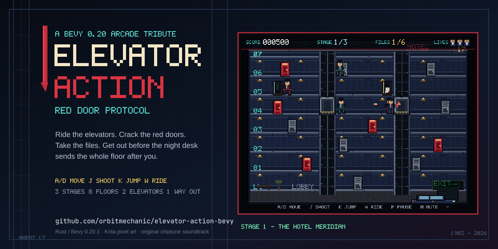
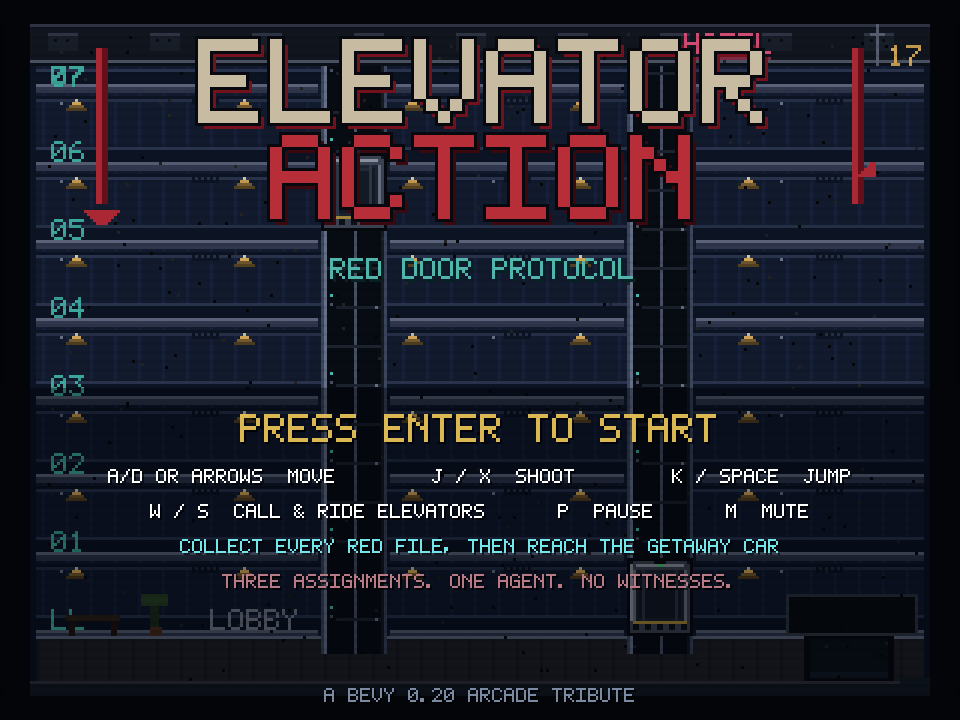
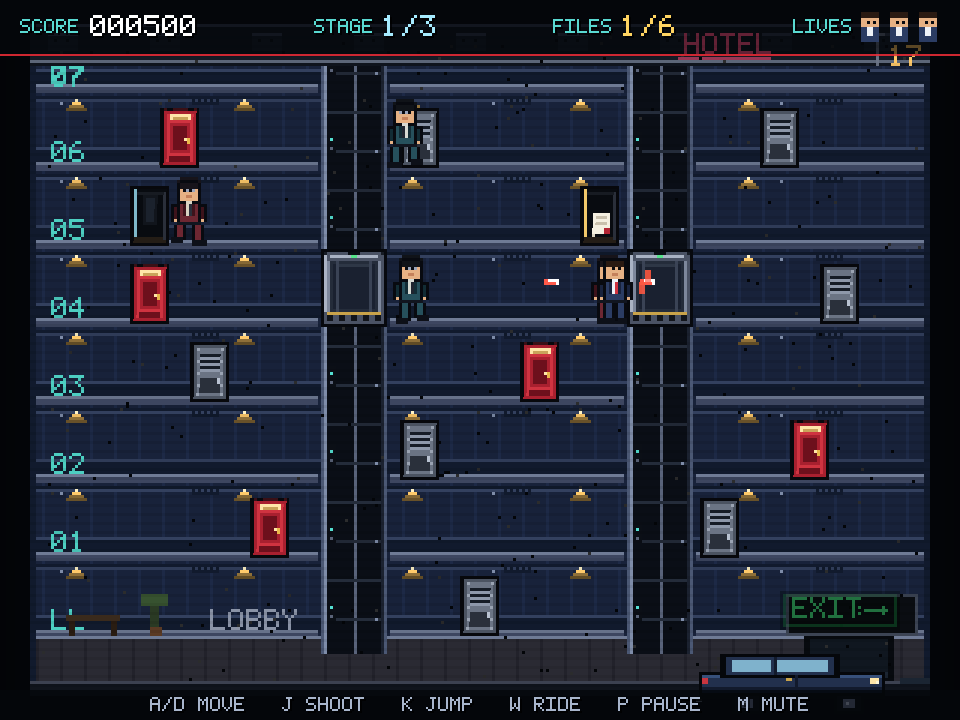
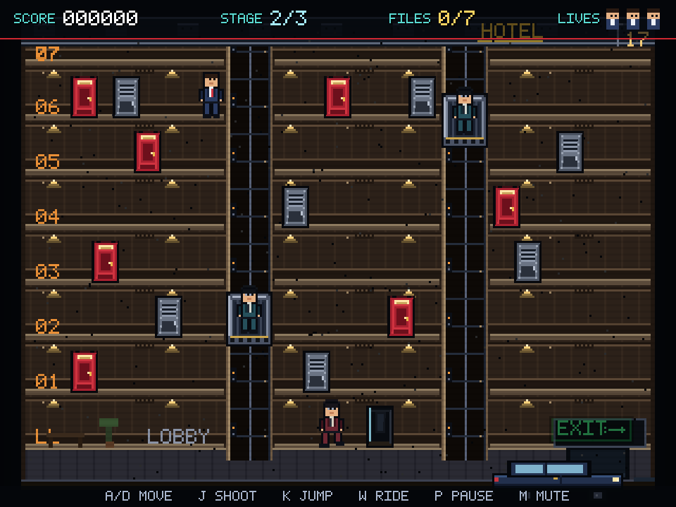
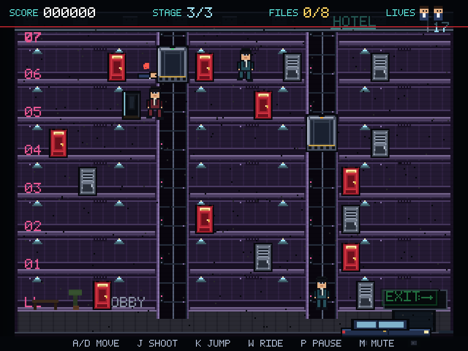
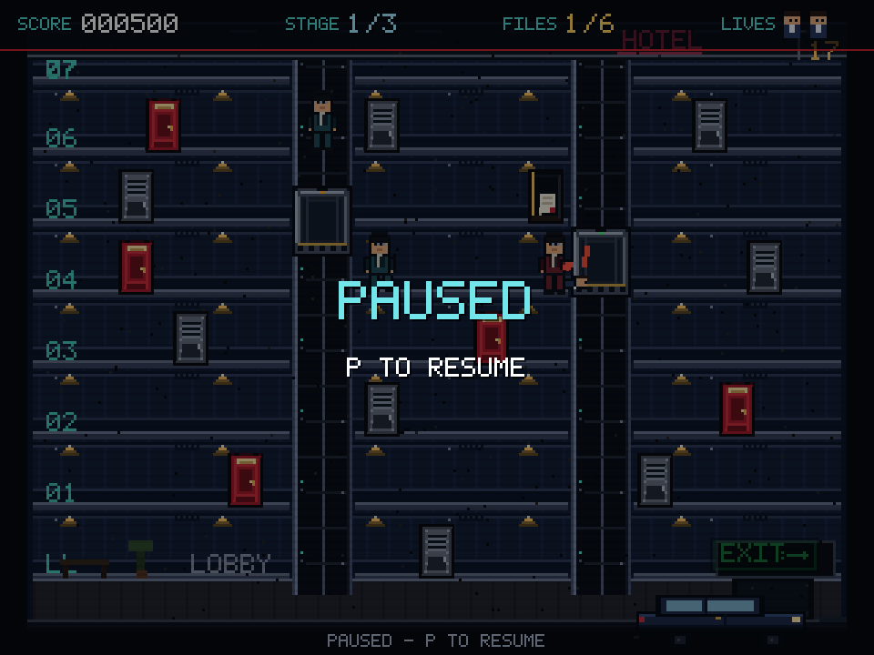
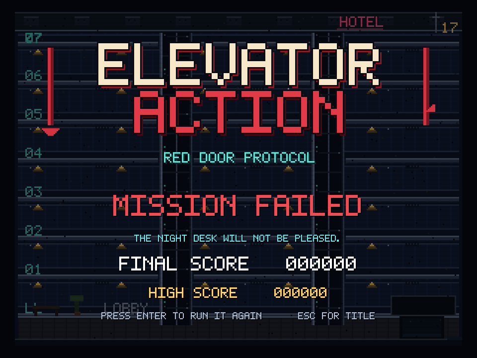

# ELEVATOR ACTION: RED DOOR PROTOCOL



A complete 2D sprite-based arcade game in the spirit of Taito's 1983
*Elevator Action*, written in Rust with **Bevy 0.20.1**. Ride two elevators
through an eight-floor hotel, crack open the red document doors, shoot the
night desk's agents, and reach the getaway car before the building closes in.

All art, animation, music, sound effects, and the pixel font in this repository
were generated from scratch for this project. No assets from the original
arcade game are used.

## Highlights

- **Three stages, eight floors, two working elevators** — cars can be called
  from any floor, ridden, and stepped out of; enemies use them too.
- **Red door / gray door loop** — red doors hold the files you need; gray doors
  spawn agents. Collect every file, then reach the car at the bottom right.
- **Full arcade loop** — title screen, three lives, one-hit deaths, respawn
  invulnerability, score, level clear, game over, and a three-stage victory.
- **Tight action** — walk, jump, duck under bullets, shoot, and use elevator
  timing to break line of sight.
- **Pixel-perfect presentation** — a 320×240 virtual arcade screen rendered at
  3× in a fixed 960×720 window, nearest-neighbour sampling, integer-snapped
  sprites, and a custom 5×7 bitmap-derived TTF font.
- **Original chiptune soundtrack and SFX** — a 16-second spy-jazz loop plus
  pistol, hit, pickup, elevator ding, death, level-clear, and game-over cues.
- **Headless-verified** — formatting, clippy, unit tests, and integration tests
  all pass; every screenshot in this README was captured from the running game.

## Screenshots

| | |
|---|---|
|  |  |
| **Title** — the Hotel Meridian at midnight | **Stage 1** — a file recovered, agents closing in |
|  |  |
| **Stage 2** — The Night Exchange | **Stage 3** — The Red Door Protocol |
|  |  |
| **Pause** — the arcade breathes | **Game over** — the night desk wins |

## Controls

| Action | Keys |
| --- | --- |
| Move | `A` / `D` or `←` / `→` |
| Shoot | `J` or `X` (hold for autofire) |
| Jump | `K` or `Space` |
| Duck (dodges chest-height bullets) | `S` / `↓` while on foot |
| Call / board an elevator | `W` / `↑` at a shaft |
| Pick a floor while riding | `W` / `S` (or `↑` / `↓`) |
| Step off a docked car | `A` / `D` (or `←` / `→`) |
| Pause | `P` or `Esc` |
| Mute / unmute | `M` |
| Start / restart | `Enter` / `Space` |

Collect a file by walking into a red door. Gray doors are where agents come
from. The exit only opens after every red file is in hand.

## Build and run

Requirements: a Rust toolchain (1.97.1+; developed on 1.99.1) and the usual Linux
graphics/audio libraries Bevy needs.

```bash
git clone https://github.com/orbitmechanic/elevator-action-bevy
cd elevator-action-bevy
cargo run
```

The first build is the expensive one (Bevy has ~570 dependencies). The dev
profile is tuned in `Cargo.toml` for a reasonable edit/run loop; for a
distribution binary:

```bash
cargo build --release
./target/release/elevator-action-bevy
```

The window is intentionally non-resizable at **960×720** (4:3). Tiling window
managers such as Hyprland normally float fixed-size windows; if yours does not,
add a float rule for the window.

## Development and verification

```bash
cargo fmt --check
cargo clippy --all-targets -- -D warnings
cargo test
cargo run
```

The suite is 15 tests (9 unit + 6 integration). It covers pure elevator movement
and docking, collision math, all level layouts, door/document collection, player
damage and life loss, respawn, stage advancement, victory transition, and the
full level-spawn pipeline.

### Screenshot / demo mode

The game can capture its own framebuffer and exit, which is how the images
above were verified:

```bash
# Title screen
cargo run -- --screenshot shots/title.png --frame 260

# Start immediately, optionally at a later stage (1-based)
cargo run -- --screenshot shots/stage2.png --frame 360 --start --level 2

# Scripted demo: walks to a shaft, rides down, collects a file, shoots
cargo run -- --screenshot shots/stage1.png --frame 480 --demo
```

`--demo` drives a deterministic input script (useful for reproducible action
shots and smoke-testing movement, elevator rides, shooting, and document
pickup). Screenshot capture waits for the scene to settle before saving, then
exits with success.

## Project deck

A 10-slide walkthrough of the game, architecture, art pipeline, and verification
lives in [`deck/elevator_action_deck.pdf`](deck/elevator_action_deck.pdf), with
the editable Impress source (`.odp`) and a PowerPoint copy (`.pptx`) alongside it.
The deck is generated by `tools/make_deck.py` (LibreOffice UNO).

## Architecture

```text
src/
├── main.rs        thin entry point
├── lib.rs         app/plugin wiring, states, input, phase timers, capture
├── world.rs       layout constants, level tables, pure elevator/collision math
├── state.rs       resources, asset handles, SFX messages, capture config
├── player.rs      movement, jump/duck, shooting, elevator boarding, respawn
├── enemy.rs       floor-aware chase AI, shooting, elevator use
├── elevator.rs    car simulation and sprite sync
├── combat.rs      bullets, particles, hit resolution, red/gray doors, exit sign
├── level.rs       level spawning, wave spawner, transitions
└── ui.rs          title, HUD, banners, pause, clear, game over/victory screens
```

A few design choices worth calling out:

- **The elevator is a resource, not just a sprite.** `CarState` owns the
  bottom position, target floor, movement, and rider count; the same state
  drives player boarding, enemy pathing, rendering, and the docking test.
- **One-hit deaths, readable hitboxes.** Ducking swaps to a 10 px-tall hitbox
  at the feet, so chest-height agent bullets pass overhead. Elevator riders
  keep their full hitbox.
- **Enemies have a floor graph in their head.** If the player is on another
  floor, an agent walks to the nearest shaft, calls a car, rides to the
  player's floor, and steps off. Cars can't be stolen from a rider.
- **No `unsafe`, no custom renderer.** The entire game is Bevy ECS: components
  for actors/doors/bullets/particles, resources for run state and elevators,
  messages for SFX, and `States` for the title/in-game/game-over/victory shell.

## Asset pipeline

The repository includes both the generated runtime assets and the source art.

| Asset | Tool / source |
| --- | --- |
| Character, door, elevator, car, logo sprites | `tools/krita_assets.py` via **Krita 6 / PyKrita**; source in `assets/art/sprite_board.kra` |
| Three building backgrounds | same script; source in `assets/art/backgrounds.kra` |
| 5×7 pixel font (`Arcade17.ttf`) | `tools/pixelfont.py` + `tools/make_font.py` (fontTools TTF builder) |
| Chiptune music and SFX | `tools/make_audio.py` (pure-Python square/triangle/noise synthesis → WAV) |
| README banner / social preview | `assets/art/banner.svg`, rendered with **Inkscape** to `banner.png` |

To regenerate everything:

```bash
python3 tools/make_font.py
python3 tools/make_audio.py
~/.agents/skills/krita/scripts/kritarun.sh tools/krita_assets.py
inkscape assets/art/banner.svg --export-type=png -w 1280 -h 640 -o assets/art/banner.png
```

## Credits

- Inspired by *Elevator Action* (Taito, 1983). This is an original homage; it
  contains no original code, art, or audio from the arcade game.
- Built with [Bevy](https://bevyengine.org/) 0.20.1.
- Art generated with [Krita](https://krita.org/); banner generated with
  [Inkscape](https://inkscape.org/).

## License

MIT. See [LICENSE](LICENSE).
